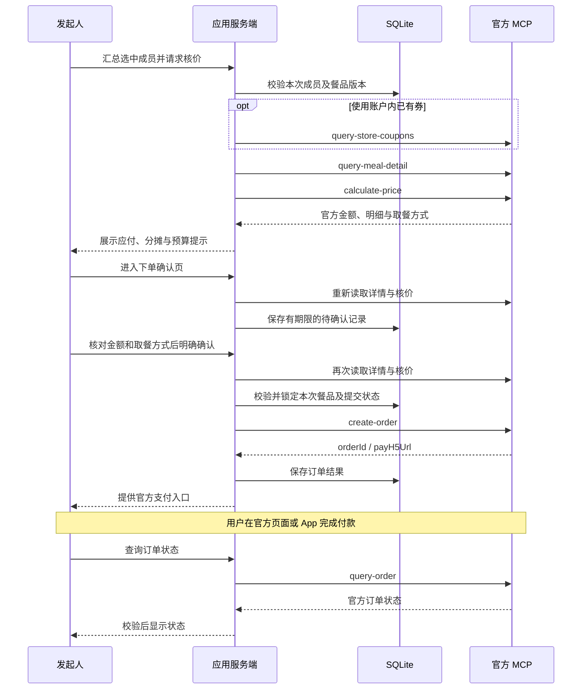

# 麦麦合拍 · 麦当劳 MCP 集成说明

更新：2026-10-22。本文说明当前代码实际使用的 Server、Tool、调用流程与业务价值，作为参赛材料。真实菜单与核价已有只读联调记录；建单、查单代码已接入并通过模拟接口测试，完整实单支付流程尚未验收。演示数据与真实 MCP 数据在界面中分开，不将计划功能描述为已实现。

## 1. 实际使用的 MCP Server

| 配置项 | 当前实现 |
| --- | --- |
| 服务 | 麦当劳中国官方 MCP Server |
| 端点 | `https://mcp.mcd.cn` |
| 传输 | Streamable HTTP |
| 授权 | 个人 MCP Token，作为 Bearer 授权由服务端发送 |
| SDK | `@modelcontextprotocol/client` 2.3.1 |
| 配置入口 | 网页右上角账号弹窗，或本机 `.env.local` / 运行时环境变量 |
| 示例文件 | 根目录 [mcp-config.example.json](mcp-config.example.json)，只含授权占位符 |

官方资料：[MCP 使用指南](https://github.com/M-China/mcd-mcp-server)、[麦当劳开放平台](https://open.mcd.cn/mcp)、[比赛仓库](https://github.com/M-China/mcd-developer-innovation-challenge)。

`MCD_MCP_URL` 仅允许官方端点；连接拒绝重定向。读取客户端每次连接后完成初始化与 `tools/list`，通过 SDK 调用白名单工具并校验返回结构，结束后关闭连接。`tools/list` 属于协议能力发现，不算独立业务工具。

示例中的 `${MCD_MCP_TOKEN}` 是否自动展开取决于所用 MCP 客户端，不能假定所有客户端都支持。本应用后端直接从运行时配置或本机加密存储读取授权，不把 Token 打包到前端。

## 2. 实际使用的 Tool 与代码对应

| 官方工具名 | 触发入口与用途 | 输入 / 输出重点 | 当前验证范围 |
| --- | --- | --- | --- |
| `query-my-coupons` | 账号连接时验证授权；CLI 查看账户已有券 | 第 1 页、每页 200 条；结果不等于当前门店可用券 | 真实只读联调、解析与授权测试 |
| `query-nearby-stores` | 用户填写城市和地标后搜索到店自取门店 | `city`、`keyword`、`searchType=2`、`beType=1`；使用返回的门店编码 | 真实只读联调 |
| `query-meals` | 门店菜单加载 | `storeCode`、`orderType=1`、`beType=1`；具体商品、官方分类、图片、展示价 | 真实只读联调、分类与图片测试 |
| `query-store-coupons` | 加载门店菜单及含券核价前刷新 | 同一门店与业务类型；只向前端返回脱敏券信息及临时引用 | 真实只读联调、门店和券实例绑定测试 |
| `query-meal-detail` | 查看餐品详情；核价和提交前重新检查搭配 | `storeCode`、`code` 等；套餐组成、数量和特制配置 | 单品、套餐只读联调及配置校验测试 |
| `calculate-price` | “官方核价”、准备确认页、确认下单前复核 | 官方详情生成的餐单及可用券；读取整数分应付金额和商品明细 | 单品、套餐、券与单点组合只读联调及异常响应测试 |
| `create-order` | 用户在确认页明确提交订单后 | 复核后的请求与 `takeWayCode`；读取 `orderId`、`payH5Url` | 代码接入；模拟接口测试，完整实单支付未验收 |
| `query-order` | 用户查询已有订单状态 | `orderId`；返回状态、支付期限及可用取餐信息 | 代码接入；模拟接口测试，完整实单流程未验收 |

代码定位：

- [只读 MCP 客户端](src/providers/mcd-readonly.ts)：前六个工具的白名单、连接、调用与券引用管理。
- [官方响应解析](src/providers/mcd-response.ts)：结构校验、商品详情、价格与图片字段转换。
- [核价请求构造](src/providers/mcd-quote.ts)：套餐配置指纹、商品与数量一致性、券实例匹配。
- [订单 MCP 适配器](src/providers/mcd-orders.ts)：隔离 `create-order` / `query-order`，校验官方支付地址。
- [本机账号服务](src/server/local-workspace.ts)、[菜单动作服务](src/server/local-mcd.ts)、[订单服务](src/server/checkout.ts)：将界面动作映射到以上适配器。

没有调用领券、积分兑换、购买权益卡、第三方团购券核销等写工具。`query-my-account` 未用于会员资格判断；菜单中的“麦金卡优惠”标记及一次核价成功，不足以证明会员有效期或全部权益。

## 3. 真实调用流程

### 3.1 连接授权、查店和选餐

1. 用户在官方平台取得个人 Token，并在本机账号弹窗中连接。
2. 服务端初始化 MCP 连接、读取工具定义，并以 `query-my-coupons` 做只读授权验证。成功后加密保存 Token；失败不替换原有授权。
3. 用户输入城市和地标，调用 `query-nearby-stores`，明确选择门店。
4. 调用 `query-meals` 和 `query-store-coupons`，展示该店商品、官方分类、商品图片与付款账号的门店可用券。
5. 查看商品时调用 `query-meal-detail`，展示当前套餐组成；根据实际选中数量构建默认搭配，并生成配置指纹。

### 3.2 共享餐桌与分批汇总

1. 发起人创建 2—6 人餐桌，将菜单快照、展示价和合法图片地址保存到共享数据库。
2. 朋友通过链接或二维码加入，独立保存昵称、预算、餐品和选好状态；页面约每 3 秒同步。
3. 发起人勾选本次结算成员，至少一位已选好的成员即可汇总。其他成员可以继续选餐。
4. 导入餐单时重新核对门店、商品、数量和套餐配置，并由付款人的授权完成后续官方核价。

朋友的加入、保存和同步使用项目自身的 SQLite/API，**不是每次操作都调用官方 MCP**。共享餐桌不共享发起人的 Token、真实券码或付款账户。

### 3.3 官方核价、确认与支付交接



报价、进入确认页和创建订单是不同步骤。仅查菜单或核价不会创建订单；`create-order` 只在明确确认且复核通过后执行，不自动重试。超时或结果不明保留 `unknown` 状态，避免误建重复订单。

只检查本次结算成员的选择版本，同时校验餐桌管理状态；所选成员改餐或被移出、餐桌取消或重开会使旧汇总失效，未选入本次的成员继续改餐不影响该批次。已提交选择被排除在后续批次之外。

## 4. 业务价值

| 用户问题 | 本项目如何使用 MCP | 带来的实际能力 |
| --- | --- | --- |
| 聊天中的“牛肉汉堡”不够具体，容易点错 | 读取门店菜单和详情，保留官方商品编码、名称、图片与搭配 | 每个人选择的是明确商品，发起人能核对套餐内容 |
| 各人预算不同，展示价也不等于最终金额 | 使用官方核价结果，结合项目的整数分分摊规则 | 看到本批次整单应付、个人分摊及超预算提示 |
| 账户有券却不知道该店能不能用 | 按选定门店查询可用券，并在核价时重新检查 | 使用付款人当前可用的权益，不把任意券都当成能用 |
| 有人选好了，有人还在犹豫 | 自建共享餐桌汇总选好成员，再调用 MCP 核价 | 可以先结算部分成员，减少人工抄单和等待 |
| 选餐与付款之间缺少衔接 | 明确确认后建单，交接官方支付入口并提供查单 | 将协作餐单接到官方订单流程，保留可追踪的订单状态 |

以上为产品能力和设计目的，没有声称已经量化验证节省时间或节省金额。分摊是应用自己的朋友间结算规则，不是官方逐人账单；不保证自动得到最低价。

## 5. 参数、授权与敏感信息处理

- 当前范围为现在下单、普通到店自取，使用 `orderType=1`、`beType=1`；未接外送、预约和车道取餐。不因为门店名称含“得来速”而更改业务类型。
- 餐单一次最多 12 份是本项目限制，不是对官方最大限额的声明。套餐使用详情当前选中的数量，校验轮次要求和特制配置，暂不支持任意换配。
- 菜单价格只作展示。应付金额使用 `calculate-price` 返回的整数分 `price`，缺失或非法金额报错，不补零；返回商品及数量必须与请求一致。
- 真实券 ID / 券码仅在服务端短连接内存中使用；前端拿到的是绑定门店和券实例的 HMAC 引用。同一张券实例不能在一次核价中重复使用。
- 本机授权使用 AES-256-GCM 加密保存，密钥留在运行电脑；独立访客使用各自的授权工作区，不自动借用发起人授权。切换账号后拒绝旧账号的迟到响应。
- 商品图片仅接受 `https://menu-img.mcd.cn/pcm/` 下的合法图片地址。缺图或加载失败显示占位，不转发 Token，不建立任意图片代理。
- 官方支付 URL 限制 HTTPS 与官方域名。没有可用链接时提示到麦当劳 App 查看订单；打开链接不等于支付成功。
- `.env.local`、数据库、密钥、订单记录、调用报告和运行日志不进入 GitHub 或发布包。公开配置只保留环境变量占位符。

## 6. 安装、配置与复现

完整安装见 [README](README.md#快速开始)。从 [.env.example](.env.example) 创建本机 `.env.local` 后，可使用以下命令检查配置与执行只读调用；不要覆盖已有配置，也不要提交真实 Token。

```bash
npm ci
npm run mcp:check-config
npm run mcp:inspect
npm run mcp:read -- coupons
npm run mcp:read -- stores 上海市 人民广场
```

取得当前门店与商品编码后，替换下面的中文占位值再执行：

```bash
npm run mcp:read -- menu 门店编码
npm run mcp:read -- quote 门店编码 商品编码
npm run mcp:read -- quote 门店编码 可用券对应商品编码 --with-coupon
```

CLI 从环境配置读取授权，不读取网页账号弹窗的加密数据库。网页只读复现流程为：连接授权 → 选门店 → 看详情 → 加入餐单 → 官方核价。需要检查跨设备选择时，按 [远程分享文档](docs/REMOTE_SHARING.md) 开启网关。

CLI 报告写入被 Git 忽略的 `artifacts/mcp/`。每次报告标明是否成功，失败会覆盖旧成功结果；这里只输出必要摘要，不将私人报告作为参赛附件发布。

## 7. 已验证范围与限制

| 范围 | 验证情况 |
| --- | --- |
| 官方能力发现与只读查询 | 已完成工具发现、账号授权验证、查店、菜单、详情和门店券读取 |
| 官方核价 | 已有单品、默认套餐、账户券与单点组合的只读联调记录；结果仅对当次上下文有效 |
| 官方图片与分类 | 已读取官方图片地址和分组，保留搜索；字段校验与异常路径有自动测试 |
| 多人协作 | 共享昵称、预算、选择、人数设置、移出及分批汇总有跨连接测试和页面验收记录 |
| 建单与查单 | 实现确认、二次复核、防重复、状态恢复和官方支付入口；使用模拟依赖验证，完整实单支付未验收 |

现有业务测试为 106 项，覆盖领域计算、接口校验、SQLite 并发、授权隔离、共享餐桌和订单状态机。详见 [验收记录](docs/VERIFICATION.md) 与 [下单说明](docs/CHECKOUT.md)。本次材料整理不重新发起真实建单或付款。

未实现的功能包括：嵌入式微信/麦当劳扫码授权、会员有效期查询、自动购卡、任意套餐替换、第三方团购券核销、自动最优优惠组合、正式公开搭子市场及真实聊天。投票、小票和固定饭搭子仍是本地演示，不描述为官方 MCP 工具。
