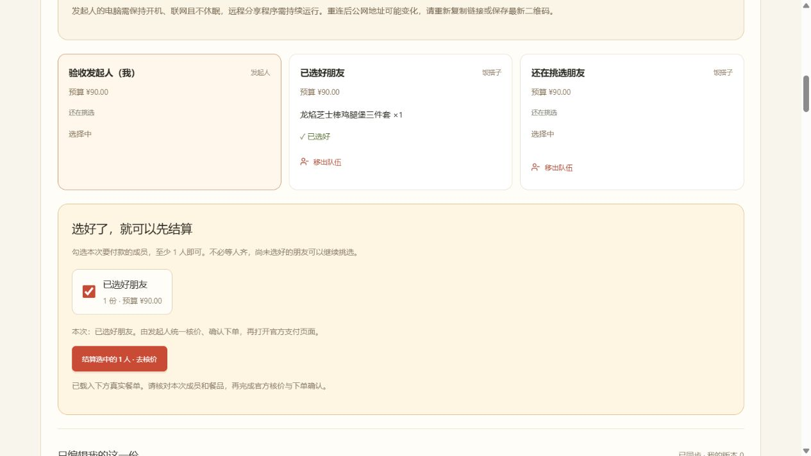
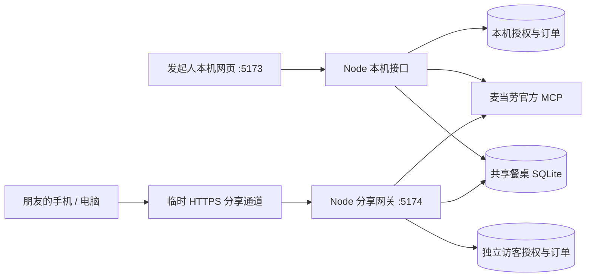

# 麦麦合拍 · 一起选，合拍吃


把朋友们的餐品、预算和选择汇到同一张餐桌。各自在手机上选餐，选好的人可以先结算，再由发起人核价、确认订单并前往官方支付。

**独立参赛项目原型，非麦当劳官方产品。** 当前运行方式为本机 Node 服务、SQLite 数据库与可选的临时公网分享通道。真实菜单、共享选餐、确认下单流程与合拍演示分别实现；本文按 **2026-10-22** 的代码状态编写。

公开参赛仓库：[Aresuae/maimai-hepai-public](https://github.com/Aresuae/maimai-hepai-public)。发布内容包含当前源码和虚构演示样例，不附带开发者的个人授权、运行数据库、真实餐桌或订单。演示入口和数据范围见 [公开版本说明](docs/PUBLIC_VERSION.md)。

[快速开始](#快速开始) · [功能与边界](#功能与边界) · [邀请朋友](#邀请朋友一起用) · [技术结构](#技术结构) · [上传 GitHub](docs/GITHUB_UPLOAD.md)

## 目标用户与使用场景

| 目标用户 | 场景与价值 |
| --- | --- |
| 同学、同事和固定饭搭子 | 2—6 人一起点餐，各自选择具体餐品和预算，汇总到同一张餐桌，减少聊天中反复确认和人工抄单 |
| 聚餐发起人、代点餐的人 | 查看谁已选好、管理人数与成员，先结算已经选好的部分，并统一核对门店、优惠与官方报价 |
| 比赛评审和 MCP 开发者 | 在本机复现菜单查询、共享选餐、核价及下单确认流程，查看服务端授权隔离和订单防重复实现 |

项目以多人协作点餐为核心；当前没有公开陌生人交友市场，同城搭子匹配仍是演示。

## 界面示例



上图为测试餐桌：一位成员已选好，另外两位仍在挑选。发起人可以先结算已选好的这一位。截图使用测试昵称，菜单图片和展示价以实际门店返回为准。

## 功能与边界

| 模块 | 当前可以做什么 |
| --- | --- |
| 真实门店菜单 | 按城市和地标查店；读取具体商品、官方图片、官方分类及套餐默认搭配；保留分类内搜索 |
| 预算与核价 | 每人设置预算，手动输入支持 ¥1—1,000；查看官方整单报价、成员分摊及超预算提示 |
| 账户优惠 | 读取当前门店可用的麦当劳账户券、展示接口返回的麦金卡优惠商品；最终资格和金额以核价为准 |
| 共享餐桌 | 创建 2—6 人餐桌，复制邀请链接或保存二维码；朋友独立填写昵称、预算和餐品，约每 3 秒同步 |
| 成员管理 | 发起人取消、重新开启合拍；每次重开重新选择名额；移出其他成员并释放名额 |
| 分批结算 | 勾选已选好的成员，至少 1 人即可先汇总；未参与本次结算的人可以继续选餐 |
| 下单与支付 | 官方核价、下单确认、提交前再次复核、防重复提交、订单状态查询及官方支付链接交接 |
| 本机账号与数据 | 右上角账号弹窗连接个人 MCP Token；服务端加密保存授权，SQLite 持久化饭局、餐桌和订单记录 |
| 找搭子发布 | 创建、编辑、取消和重新招募自己的饭局；过期饭局可以取消，改为未来时间后可重新招募 |
| 合拍演示 | “我请客”、匿名投票、随便按钮、默契小票 SVG、固定饭搭子模板与同城匹配演示 |

以下内容仍有明确边界：

- **同城匹配是演示**，发布保存到当前工作区，尚无公开招募市场、真实聊天或真实报名通知。
- **登录采用个人 MCP Token**。页面提供官方平台入口，未实现本应用内的微信/麦当劳扫码登录、OAuth 或正式用户注册。
- **共享餐桌已支持跨设备选餐**，投票、小票和固定饭搭子仍属于本地演示；换设备、清除 Cookie 或换公网域名后，访客身份不能自动找回。
- **第三方团购券未核销接入**，美团、抖音券不能直接在本页核销；没有自动购买麦金卡、任意套餐换配或自动寻找最优优惠组合。
- **支付在官方页面或麦当劳 App 完成**。本项目不收款，不支持一笔官方订单由多人分别支付；页面分摊只是朋友间的结算参考。
- 建单和查单已接入代码，自动测试使用模拟接口。菜单、核价及共享流程有只读联调记录，**不把这些验证描述为完整实单支付验收**。

## 快速开始

### 1. 准备环境

- Node.js **22.13 或更高版本**；本机验证环境为 Windows、Node.js 24.18.0。
- npm；通过 Git 克隆时需要 Git，也可以下载源码 ZIP 后解压。
- 如需公网分享，准备 OpenSSH 客户端及可用网络。Windows 启动脚本使用系统 OpenSSH。

在解压或克隆后的**项目根目录**执行：

```bash
npm ci
npm run dev
```

打开 [本机首页](http://127.0.0.1:5173/)；设计概览位于 `/design`。Windows PowerShell 若阻止 `npm.ps1`，使用 `npm.cmd` 替代命令中的 `npm`。

没有 Token 也能切换到「合拍演示」。真实点餐需要先连接自己的麦当劳授权；连接失败不会自动拿演示数据冒充真实菜单。

演示餐品、金额、成员和招募饭局均为虚构样例，上海商圈仅用于展示筛选，不表示有人真实在线。真实点餐页初始城市和地标为空，由使用者自行填写并点击查找门店；不会预填开发者的测试位置。

### 2. 连接个人授权

推荐从首页右上角「账号登录 / 我的账号」打开弹窗：

1. 点击「去官方平台登录」，在 [麦当劳开放平台](https://open.mcd.cn/mcp) 按官方流程获取自己的 MCP Token。
2. 回到本机网页，粘贴 Token，点击「验证并连接账号」。验证通过后由服务端加密保存。
3. 选择城市、商圈或地标，读取门店菜单。默认搜索位置可在页面修改。

CLI 用户也可以将 `.env.example` **复制为新的** `.env.local`，在本机编辑配置，已有配置不要覆盖：

```dotenv
MCD_MCP_TOKEN=填写你自己的Token
MCD_MCP_URL=https://mcp.mcd.cn
```

网页可以「验证并保存已有授权」。断开网页连接后不会自动回退使用环境中的 Token；CLI 的显式配置独立生效。授权不放入前端公开变量，也不需要发给同桌朋友。

### 3. 持续运行本机程序

```bash
npm run local:keepalive
```

Windows 也可双击根目录的 **`本机持续运行.cmd`**。与 `npm run dev` 二选一，避免重复占用 5173 端口。守护脚本会在异常退出后有限重试，不会设置系统服务、开机启动或自动禁用休眠。

## 使用示例：三人午餐，先结算选好的人

以下为操作示例，昵称和预算均为示意，不是固定菜单或成交报价。

1. 发起人连接个人授权，搜索城市和地标，选择到店自取门店并加载真实菜单。
2. 创建 3 人共享餐桌，开启远程分享，将链接或二维码发给两位朋友。
3. 三人分别填写预算，例如 ¥50、¥40、¥35；在官方分类中查看图片、搜索餐品并保存自己的选择。
4. 一位朋友点击「我选好了」，另两位继续挑选。发起人只勾选已选好的这一位，点击结算入口导入本次餐单。
5. 发起人检查套餐内容，按自己账户的门店可用券选择优惠，再请求官方核价；查看整单应付与预算提示。
6. 若要真实下单，继续到确认页核对取餐方式和金额，明确确认后创建订单，再前往官方支付；仅体验时停在核价即可。

没有个人授权时，可切到「合拍演示」体验预算、我请客、匿名投票和默契小票；这些演示不创建官方订单。

## 邀请朋友一起用

保留本机服务，在**另一个终端**执行：

```bash
npm run share:build
npm run share:start
```

Windows 可直接双击 **`远程分享启动.cmd`**，脚本会先构建再启动。

1. 发起人在本机网页连接授权、读取门店菜单，创建共享餐桌并设置名额。
2. 通道连接成功后，餐桌卡片显示专属邀请链接与二维码；复制链接或让朋友扫码。
3. 朋友在其他设备、其他网络打开邀请，填写昵称和预算加入。只参加共享选餐无需提供 Token。
4. 每人保存餐品并点击「我选好了」，发起人勾选本次结算成员，再点击「结算选中的人数 · 去核价」。
5. 核对本次成员与餐品，官方核价后进入下单确认，明确提交后才创建订单；付款由发起人在官方页面完成。

电脑必须保持开机、联网且不休眠，两个服务都需保持运行。临时通道断线会重试，公网域名可能改变；以页面最新链接和二维码为准。**GitHub 仓库用于存放源码，上传源码本身不会让应用上线；GitHub Pages 也不能运行本项目的 Node/SQLite 业务接口。**

| 入口 | 用途 |
| --- | --- |
| `127.0.0.1:5173` | 本机所有者工作区，连接自己的授权 |
| `127.0.0.1:5174` | 独立分享网关的本机入口，使用访客会话 |
| 页面生成的 HTTPS 邀请 | 外地朋友加入同一张餐桌 |

完整操作和网络限制见 [远程分享说明](docs/REMOTE_SHARING.md)。不要把 5173 开发服务器直接映射到公网。

## 合拍与订单规则

- 餐桌名额为 2—6 人，包含发起人；结算至少 1 位已选好的成员即可。待结算餐品合计最多 12 份。
- 取消合拍会暂停邀请和选餐，保留成员、预算及已保存餐品。重新开启时选择人数，有效期从重开起计算 24 小时；缩小到少于现有成员的名额前需先移出多余成员。
- 移出成员不会取消其已创建的官方订单。被移出的当前访客身份不能继续访问这桌；这不是基于真实账号的永久封禁。
- 本次结算成员改餐、被移出，或餐桌取消/重开，会使旧汇总失效；未选入本次的成员继续改餐不影响该批次。
- 核价只生成报价；确认页需要核对门店、套餐、金额和取餐方式，再手动确认。当前支持现在下单、普通到店自取，未接入外送、预约及车道取餐。
- 已提交的选择会标记并排除在后续汇总之外。其余成员可以继续选餐；已提交成员如需另点一单，可新建餐桌。
- 当前账号已有待处理订单时，先点击「查看我的订单与支付」查询处理，再提交下一单。结果未知时停止重试；缺少订单号的未知结果目前没有自动对账和解除阻塞界面。
- 没有可用官方支付链接时，转到麦当劳 App 的「我的订单」付款。打开链接不代表支付成功，状态以官方查询为准。

详见 [下单与支付](docs/CHECKOUT.md)。

## 技术结构

| 层次 | 实现 |
| --- | --- |
| 页面 | React 19、TypeScript、Vinext/Vite、Tailwind CSS、Radix UI |
| 本机接口 | Vite Node 中间件；同源 JSON POST、账号版本校验 |
| 分享服务 | 独立 Node HTTP 服务、编译后的 SPA、隔离的访客会话与工作区 |
| 数据 | Node 内置 `node:sqlite`、WAL、事务与版本冲突检测 |
| 官方能力 | MCP 客户端 SDK、只读菜单/核价适配器、独立建单与查单适配器 |
| 同步与邀请 | 每 3 秒轮询、餐桌随机邀请、二维码、临时 HTTPS 隧道 |



共享的是餐品、预算及状态，不共享付款账户的授权和卡券。Token 使用 AES-256-GCM 加密保存；密钥也位于服务电脑，因此不能将其描述为对电脑管理者保密。

```text
app/                       首页、设计概览与样式
src/components/            共享餐桌、菜单、账号、下单及找搭子界面
src/domain/                金额、成员、选餐、邀请、投票等领域规则
src/providers/             官方 MCP 适配与演示数据
src/server/                SQLite、共享餐桌、访客会话和订单服务
src/client/                浏览器接口调用
src/share/                 独立分享入口
build/mcd-local-api.ts      本机 Node 业务接口
scripts/                   启动、构建、MCP 调试及 GitHub 打包
tests/                     领域、接口、同步、授权隔离和订单测试
docs/                      使用说明、技术文档、验收与上传指南
.github/workflows/         GitHub 自动检查
.openai/hosting.json        构建所需的空绑定配置；不是账号凭证
vendor/                    随附的第三方样式与原许可证
```

`components/`、`lib/`、`db/`、`drizzle/` 和部分构建脚本保留通用 starter 基础设施。Drizzle/D1、R2、ChatGPT 登录与连接器示例没有作为当前业务存储或用户体系启用。

## 常用命令与检查

```bash
npm run typecheck
npm test
npm run build
npm run share:build
```

当前业务测试 **106/106 通过**。覆盖金额分摊、授权隔离、跨连接同步、人数与移除权限、部分成员结算、报价失效及防重复下单。浏览器与网络验证范围见 [验收记录](docs/VERIFICATION.md)；GitHub workflow 的实际结果以仓库运行记录为准。

| 命令 | 用途 |
| --- | --- |
| `npm run dev` | 本机开发预览 |
| `npm run local:keepalive` | 本机服务持续运行及有限重试 |
| `npm run share:build` | 生成 `dist/share` 分享客户端 |
| `npm run share:start` | 启动分享网关及临时公网通道 |
| `npm run share:start -- --local-only` | 仅验证本机分享网关，不启动公网通道 |
| `npm run mcp:check-config` | 检查本机 MCP 配置，不打印 Token |
| `npm run mcp:inspect` | 发现官方工具定义 |
| `npm run mcp:read -- stores 城市 地标` | CLI 只读查询门店 |
| `npm run github:export` | 检查发布内容并生成源码目录、ZIP 和文件清单 |

`npm run build` 生成原 Worker 构建，`npm start` 是该产物的本地预览，**不提供当前 Node SQLite 业务接口**。完整功能使用本机服务与分享网关。原构建可能重建 `dist`，之后启动分享前需再执行 `share:build`。

## 参赛材料索引

按 [比赛官方仓库](https://github.com/M-China/mcd-developer-innovation-challenge#开发-skill) 与 [活动规则](https://github.com/M-China/mcd-developer-innovation-challenge/blob/main/activityGuidelines.md) 核对，以下材料位于仓库根目录或所列源码目录：

| 材料 | 本仓库对应内容 |
| --- | --- |
| [README.md](README.md) | 项目介绍、目标用户、安装步骤、使用示例及功能边界 |
| [CONTEST_DECLARATION.md](CONTEST_DECLARATION.md) | 官方参赛声明原文件；文件名及内容保持不变 |
| [MCP_INTEGRATION.md](MCP_INTEGRATION.md) | 实际使用的 MCP Server、8 个业务工具、调用流程、业务价值与验证范围 |
| 源代码 | [app/](app/)、[src/](src/)、[build/](build/)、[scripts/](scripts/) 及 [tests/](tests/) |
| [mcp-config.example.json](mcp-config.example.json) | 脱敏配置示例，授权使用环境变量占位符 |

参赛声明直接取自 [官方固定版本](https://github.com/M-China/mcd-developer-innovation-challenge/blob/c51074fde6a12786b6fe76091aefbb69acdffd5b/CONTEST_DECLARATION.md)，未在声明正文中添加项目名、署名或其他说明。`npm run github:export` 会校验声明原文的 SHA-256，并确保必需文件进入源码包。

`workbuddy.md` 仅在申请 WorkBuddy 专项奖励时需要，必须来自真实的 WorkBuddy 开发对话。目前未提供此记录，不能据此宣称已满足专项条件。仓库上传和材料补齐也不等于已完成比赛报名，报名状态以官方 Issue 回复为准。

## 数据、发布与文档

运行数据保存在 `data/`：本机授权、饭局、共享餐桌、订单、访客工作区、密钥及临时通道信息。固定饭搭子模板保存在浏览器。备份时停止服务并完整备份数据目录及密钥；备份不是源码，不要上传到仓库。

`.env.local`、`data/`、`node_modules/`、构建产物、日志和本机截图已由忽略规则排除。发布用截图仅放在已检查的 `docs/images/`。上传步骤、推荐仓库简介和 ZIP 使用方法见 **[GitHub 上传指南](docs/GITHUB_UPLOAD.md)**。

| 文档 | 内容 |
| --- | --- |
| [本机运行](docs/LOCAL_RUNNING.md) | 启动、授权、数据库与备份 |
| [远程分享](docs/REMOTE_SHARING.md) | 链接、二维码、成员管理及通道限制 |
| [下单与支付](docs/CHECKOUT.md) | 确认流程、分批结算、订单恢复 |
| [MCP 集成](MCP_INTEGRATION.md) | 适配器、只读命令及联调记录 |
| [参赛声明](CONTEST_DECLARATION.md) | 官方原文，文件名及内容不可修改 |
| [公开版本说明](docs/PUBLIC_VERSION.md) | 无 Token 演示、包含的数据和公开发布范围 |
| [产品方案](docs/PRODUCT.md) / [技术架构](docs/ARCHITECTURE.md) | 原始设计与扩展方向，包含尚未实现的计划 |
| [API 草案](docs/API.md) / [路线图](docs/ROADMAP.md) | 设计草案，实际接口以 `src/server` 代码为准 |
| [验收记录](docs/VERIFICATION.md) | 按日期记录的实现、验证及限制 |

目前未为本项目源码指定整体开源许可证；随附第三方代码保留其原许可证，见 [第三方说明](THIRD_PARTY_NOTICES.md)。麦当劳名称、商品图片和菜单数据属于相应权利方，本项目不表示官方授权或背书。
