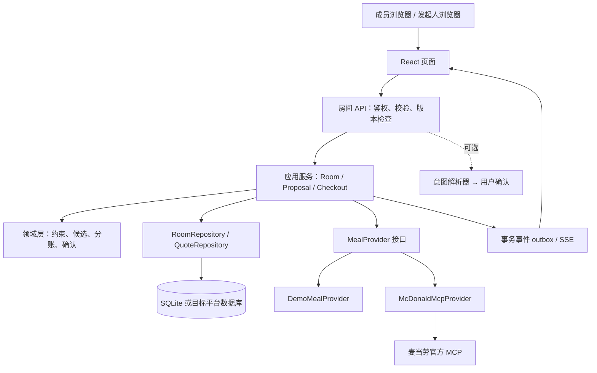

# 麦麦合拍 · 技术架构 v0.2

更新：2026-10-19。目标：单人可维护、后续功能可以替换或扩展。第 11 节为多人目标设计；本机单所有者 SQLite 与个人授权现已接入，见 LOCAL_RUNNING.md 和下方实现说明。

本机实现：`src/server/local-database.ts` 使用 Node 内置 SQLite（WAL、busy_timeout、schema version、事务），持久化个人授权和饭局发布；原 localStorage 发布按 ID 导入且不覆盖新数据。`/api/local` 与 `/api/mcd` 都仅限本机同源 JSON POST。Token 经官方只读查询验证后 AES-256-GCM 加密入库，密钥单独位于被忽略的 data/credential.key；不抵御能读取完整数据目录的本机攻击者。断开状态持久化禁止环境 Token 回退，授权版本保护请求和迟到响应；数据库中无账号手机号、原始券凭证或支付链接。发布集合 revision 在 SQLite 事务内比较。页面收到授权变化会重置真实餐单，失败验证不替换旧授权。该模式不提供跨用户鉴权，不能把本机接口直接开放到公网。

本轮新增的领域模块与状态见 [v0.2 扩展说明](FEATURES_V02.md)：付款策略、投票轮次、可变成员、约束随机、浏览器模板与小票渲染。它们是纯函数，可迁移到下一阶段服务端应用服务中。

## 1. 技术选择

| 层 | 选择 | 原因与限制 |
| --- | --- | --- |
| 页面 | React + TypeScript | 交互状态复杂，类型可复用 |
| Web 运行时 | Sites 提供的 Vinext/Vite starter，Next App Router 风格 | 使用已有本地预览基础；Vinext 为 beta，需要构建和浏览器验证，业务层保持独立 |
| API | 同仓库 route handlers | 初期避免维护两个部署单元 |
| 领域逻辑 | 无框架 TypeScript 纯函数 | 分账、约束、版本行为可独立验证 |
| 数据访问 | 本机 Node SQLite 已接个人授权与饭局；多人 RoomRepository 待实现 | 若使用 Workers，需选择 D1 或外部数据库，不能直接用本机 SQLite 文件 |
| 实时同步 | POST 命令 + SSE 事件 + 完整快照恢复 | 当前未实现；单实例起步，多实例必须增加广播/共享事件存储 |
| MCP | 服务端供应商适配层，采用官方 SDK 实现 Streamable HTTP | 先 tools/list，再按真实 schema 编写映射；不猜测字段 |
| AI | 可选意图解析适配器 | 核心流程不依赖 LLM；解析输出须经 schema 校验和用户确认 |
| 测试 | Node test runner + TypeScript 检查 + 浏览器验收 | 金额/并发不变量优先，不追求无意义测试数量 |

starter 自带的 auth、连接器、D1 示例和 UI 组件目前只是可用脚手架，不代表产品已经接入这些服务。

## 2. 逻辑分层

本轮实际实现 UI、纯函数 DOMAIN、演示数据与报价策略、provider 契约和状态查询 API。图中的完整 provider 服务、数据库与协作服务为目标架构。

## 3. 数据模型

所有主键使用不可预测的 ID；所有金额字段显式标注 Cents。房间码是展示/加入信息，不能代替权限。

| 实体 | 关键字段 |
| --- | --- |
| Room | id, title, hostMemberId, storeRef, diningMode, phase, revision, expiresAt |
| PaymentPolicy | split 或 treat；payerId、totalBudgetCents；随方案保存快照 |
| VoteRound / Ballot | round、phase、candidateIds；memberId + round 唯一票，服务端只公开汇总 |
| BuddyGroup | schemaVersion、id、name、成员偏好白名单；当前仅本地模板 |
| Member | id, roomId, displayName, status, joinedAt |
| Preference | memberId, version, budgetCents, requiredItems, preferredItems, excludedItems, acceptsSharing |
| MenuSnapshot | id, provider, storeRef, contextHash, fetchedAt, items, schemaVersion |
| Candidate | id, roomRevision, menuSnapshotId, lines, ruleCoverage, conflicts, searchScope |
| Quote | id, candidateHash, provider, source, totalCents, lineAmounts, fees, discounts, quotedAt, expiresAt |
| Proposal | id, version, quoteId, allocationVersion, contentHash, status |
| Allocation | proposalId, memberId, personalCents, sharedCents, feesCents, discountCents, totalCents（餐品价值）, payableCents（应付） |
| Confirmation | proposalId, memberId, proposalVersion, confirmedAt；唯一键 proposalId/memberId/version |
| CheckoutAttempt | id, proposalId, idempotencyKey, status, providerOrderRef, safeErrorCode |
| RoomEvent | sequence, roomId, type, roomRevision, publicPayload, createdAt |

真实报价保存对应菜单、上下文、餐品、券与分账策略版本，不能把新购物车和旧金额拼在一起。MCP 原始响应默认不持久化；需要诊断时保存严格脱敏的受限记录。

## 4. 房间状态与一致性

目标状态：COLLECTING → PLANNING → REVIEWING → CONFIRMED → REPRICING → READY_TO_ORDER → ORDERING → ORDER_CREATED → CLOSED。

REVIEWING 中任意成员改偏好 → COLLECTING；重新选方案 → REVIEWING 并增加版本；REPRICING 有任何影响内容的变化 → REVIEWING；报价过期 → REPRICING。订单创建后的修改通过独立流程处理，不能直接修改历史餐单。

首版页面只使用 collecting / reviewing / confirmed 三个状态，不伪造交易状态。

**写入协议**：客户端每个命令带 expectedRevision。服务端在单事务中读取当前版本、校验身份/命令/状态、修改数据、revision + 1、写入 outbox。版本不匹配返回 409 与最新快照；前端保留未提交输入并提示合并，不静默覆盖。

**生成异步竞争**：生成任务携带房间 revision；执行期间有人编辑时，迟到的报价不可发布为新方案。服务端只接受输入版本仍匹配的结果。

**SSE 恢复**：事件含 sequence；重连携带 Last-Event-ID。无法补齐时重取快照。后端为事实来源，SSE 只是通知通道。预算、Token 等私有字段不能放进公共事件。

## 5. 组合与报价

1. 标准化偏好，检查自相矛盾的要求。
2. 根据真实菜单构造可选餐品与合法套餐选项，禁止使用不存在的 SKU 或猜测可替换项。
3. 先生成每人的可行候选，裁剪明确超预算/不符合必选项的路径。
4. 合并为小规模整桌候选；硬约束过滤；按软偏好满足数、实际支付额和额外餐品数排序。
5. 对有希望的有限候选请求官方核价，限定调用次数和超时。仅有菜单展示价的路径不得标记为已核价。
6. 将优惠、费用按已公示规则分摊，重新检查每人的预算。
7. 去重后最多输出 3 套；不足 3 套就少显示，全部失败则显示可执行的调整建议。

目标是有界搜索中的可解释好方案。全局穷举可能造成组合爆炸和过多 API 调用，因此不承诺全局最优。

当前演示使用固定虚构单品价格和三个确定性策略，只验证交互与不变量，不模拟真实套餐/优惠规则，也不用于证明省钱效果。

## 6. 分账

给定非负整数 amountCents 与正权重：先按权重取整数部分，再按余数从大到小分配剩余分；相同余数使用稳定 ID 排序。所有中间值需在安全整数范围内。

共享项目由选择参与的人分摊。商品级优惠先落到相应商品，订单级优惠只在适用范围明确时按规则分配。费用作为独立账目，不藏在餐品单价中。分账策略版本随方案保存。

下单前满足：sum(totalCents) = sum(payableCents) = quote.totalCents；金额均非负。各付各的需每人应付 ≤ 本人预算；请客模式需整桌总额 ≤ 请客预算、请客人应付总额、其他人应付 0。所有餐品都有明确归属或显式共享，当前成员均确认当前版本。

## 7. 供应商接口边界

MealProvider 提供菜单获取与核价能力，返回归一化模型及来源。Demo provider 与 MCP provider 使用同一接口；真实模式未配置或联调失败时返回清楚的错误，绝不静默回退演示结果。

当前已实现 demo provider、真实只读 MCP 适配器和本机开发接口。MCP 适配器已读取 tools/list、保留脱敏 schema 并验证真实菜单/核价；没有实现 CheckoutService。完整清单见 MCP_INTEGRATION.md。

后续 CheckoutService 使用独立的订单端口；读取数据的 provider 不隐式创建订单。写调用重试策略与读取不同，超时未知必须先查状态。

## 8. 身份、凭证与数据生命周期

当前无应用登录，房间、选票、同城匹配演示申请只在 React 内存保存，刷新重置。真实菜单接口使用本机服务端 Token。固定饭搭子与本机发布经用户显式保存后写入 localStorage，采用版本格式及字段白名单；不存选票、确认、Token 或付款承诺。单浏览器角色切换不具备真实匿名隔离。

真实阶段：成员使用单独会话凭证，服务端 HttpOnly/SameSite cookie；邀请链接只能加入，不能获得 host 权限。控制人数和请求频率。所有写请求校验 Origin/会话/权限/输入长度与版本；对导出内容做文本处理，避免注入。

开发者 Token 只放在本地 .env.local，禁止 NEXT_PUBLIC 前缀；不打印请求 Authorization、不提交 Git、不返回前端。公开部署不能把开发者账户做成全站共享付款账户；真实多房间需逐发起人隔离凭证或采用用户自行部署模式。具体托管方案在联调后确定。

目标房间默认 24 小时过期；到期删除成员偏好、会话和临时凭证。需保留的订单/账单由用户明确选择。日志只记录操作类型、耗时、受限错误码及脱敏标识。

## 9. 扩展点

- 语音/群聊导入 → IntentParser → PreferenceDraft → 用户确认。
- 投票/默契玩法 → ProposalSelectionPolicy，只对可行候选排序。
- 固定饭搭子 → PreferencePresetRepository，复制成新房间偏好。
- 我请客/AA → AllocationPolicy，重新生成方案并确认。
- 图片/双语餐单 → ReceiptRenderer，共用已确认快照。
- 营养展示 → NutritionEnricher，缺数据标明未知，不改变价格源。
- WorkBuddy Skill → 调用同一应用服务，不绕过成员确认和 host 权限。

## 10. 部署与可观测性

本轮只本地运行。目标首个多人版本采用单实例 Node + SQLite，数据访问与实时广播均在该实例；若部署到 Workers，数据库适配与 SSE 运行限制需单独验证。不要把内存 Map 当作可扩展的生产存储。

记录候选数、核价成功率、工具超时、冲突原因、确认完成耗时。健康检查只报告组件是否可用，不报告 Token 值。上线前检查移动端、两浏览器并发、服务重启恢复、报价过期和重复建单。

## 11. 同城匹配与多账户订单（目标架构，尚未实现）

当前页面分成两个保持挂载的入口，切换不重置已有餐单。BuddyDiscovery 使用独立虚构 fixture，领域函数只处理硬筛选、可解释偏好排序和演示申请状态，不接触真实餐单、MCP 凭证或生产用户。不要把浏览器中的“模拟对方同意”作为服务端 API 权限依据。

本机发布扩展：buddy-publishing.ts 校验上海时区日期、固定时段、2—6 人、整数分预算、标题/位置长度与标签；发布者固定占 1 位。localStorage 键 maimai-published-buddies-v1 仅作为旧数据迁移来源，当前以 SQLite 为事实来源，最多 20 条；事务内比较集合 revision，服务端重做业务校验。页面定期读取最新记录，不覆盖编辑草稿。发现列表排除过期/关闭记录，指定日期时不混入无日期样例。数据库并发保护已实现，但单所有者模型不具备跨用户权限隔离。

### 服务与模型

| 服务/实体 | 职责与约束 |
| --- | --- |
| IdentityService / User / Session | 应用账号、登录会话、登出；正式版选择成熟身份服务，服务端验证会话。开发角色切换不算认证 |
| Profile | 昵称、城市编码、主动公开的商圈与标签；手机号、凭证和付款信息不进入公开资料 |
| Gathering | hostUserId、cityCode、area、startsAt/endsAt（UTC）、joinDeadline、capacity、version、paymentMode、状态；索引 cityCode + startsAt + status |
| JoinRequest | gatheringId + applicantUserId 唯一活动申请；pending → accepted/declined/withdrawn/expired。只有发起人可接受/拒绝，申请人可撤回 |
| DiscoveryService | 先过滤城市、时间、预算交集、名额、拉黑关系，再按主动选择的相同标签排序；分页与频率限制，不需要向 LLM 发送资料 |
| BuddyRelationship | 好友邀请须双向同意；单方书签私有。Block 双向排除发现与申请；Report 保存举报原因和处理状态 |
| RoomService | 接受申请事务创建/加入真实房间，继续使用 revision 与现有确认协议；数据库容量约束，不能只依赖 UI 按钮 |
| CredentialVault / McdAuthorization | userId、provider、密文凭证引用、状态、授权时间；与应用密码/会话分离，密钥来自服务器秘密管理；不保存到浏览器 |
| CheckoutService / Order | payerUserId、roomId、confirmedProposalVersion、授权引用、官方订单引用；按付款人授权，绝不采用客户端传入的 Token 或任意账户 ID |

接受申请在一个事务里检查：授权发起人、expectedVersion、饭局未关闭/过期、双方未拉黑、申请仍 pending、成员尚未加入且仍有空位；成功才增成员/版本、失效旧餐单确认、记录 outbox。最后一个位置只能被一个申请占用。失败返回 409 并刷新状态。各自下单模式保存每位付款人的独立 CheckoutAttempt，不假设多笔官方订单具备原子提交。

### 支付链路

1. 报价适配层需要保留并验证 calculate-price 的 takeWayList；建单时 takeWayCode 必须取自当次合法选项。当前只读 UI 尚未实现此选择，不填猜测值。
2. 发起人不一定是付款人。仅真实付款人能确认当前不可变快照（餐品/选配/券、门店、取餐方式、总额、分摊、版本）；金额或任何内容变化退回确认。
3. 创建 CheckoutAttempt（唯一的 payer + proposalVersion + contentHash），数据库锁定此尝试并禁用重复点击，随后由独立写适配器调用 create-order。现有 McdReadOnlyClient 的六项白名单保持只读。
4. 已查看 schema 未提供商户幂等参数，应用锁不等于官方幂等。超时或连接断开进入 UNKNOWN，不自动重发 create-order；有 orderId 时 query-order，无 orderId 时用已授权的 order-list 辅助核对，存在歧义时交给用户在官方订单页核实。
5. 成功返回的 payH5Url 仅经服务端验证 HTTPS 与已核实的官方支付域名后供所属付款人打开；域名和跳转行为需实际受控联调，当前不猜 URL。链接按敏感订单数据处理，不写日志/公共 SSE/分享小票。
6. 用户在官方页面完成支付。回到网页只触发 query-order；官方明确状态才标记 PAID。支付截止时间到达仍须查单，不假定页面本地倒计时等于官方取消。未知状态原样归为“待核实”。
7. 取餐码/取餐柜信息只发给有权取餐者；公共饭局仅显示对应成员的订单进度，不广播支付凭证。

公开文档目前只核实了个人 Token 接入方式，未核实第三方 OAuth 授权、refresh token、支付回调签名或一单多人支付协议。先向官方确认多用户接入方式，再实现凭证绑定。应用层“各付各的”分账与官方多笔支付是两个概念。

服务端验收重点：跨账户订单/券/支付链接不可读；非发起人不可接受申请；满员并发只能成功一次；拉黑后无法新申请或私信；撤回/过期申请不能复活；旧确认与重复点击不创建新订单；打开支付链接不会变成已支付。单机匹配测试不代表这些服务端验收已通过。
